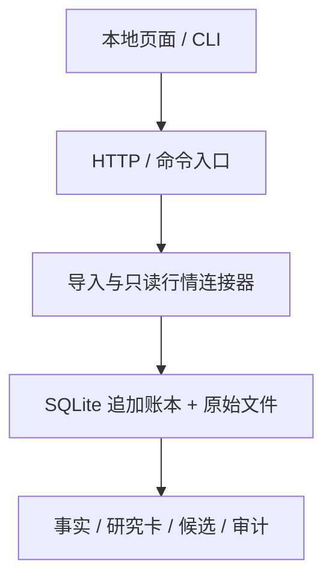

# 威科夫投研工作台 V0.6.2 架构审查与优化验收

日期：2026-10-09  
审查对象：V0.6.1 源码包；本包以独立工作副本升级到 V0.6.2，原 V0.6.1 包未改写。  
审查范围：本地数据流、研究/候选账本、审计、HTTP 输入契约、打包边界及离线验证。

## 结论

工作台的核心边界设计清楚：来源快照和本机采集原文分开保存；SQLite 追加账本作为权威记录；研究卡保留事实依赖与冻结时间；审计会复算事实并检查候选状态时间链。绩效回测、前瞻 Shadow、生产权限和自动订单仍为 BLOCK。

本版落地了两项代码改进：候选状态查询和审计将事件按候选ID预分组；POST 接口落实文档已有的 JSON Content-Type 要求。没有改行情计算公式、候选转移条件、PIT声明或投研闸口。

## 架构路径

研究事实仅使用观察截止日前可见的行；候选推进需要后续采集的新快照、新行情日期和可追踪证据。来源SHA-256能检查本机文件是否与账本记录一致，不能认证供应商真实性、完整性或历史可得时间。

## 发现与处置

| 编号 | 优先级 | 发现 | 本版处置 |
|---|---|---|---|
| R1 | P2 | `candidate_view` 对每个候选遍历全部候选事件；`reports.audit` 也为每个候选重新过滤全量事件，增长后接近 O(C×E)。 | 两处先按 `candidate_id` 建索引，再按账本顺序处理；事件关联准备从 O(C×E) 降为 O(C+E)，状态先后语义保持不变。见 `wyckoff_cn/research.py:196`、`wyckoff_cn/reports.py:38`。 |
| R2 | P2 | 接口文档要求 JSON Content-Type，但原服务只解析 JSON 字节，没有拒绝错误媒体类型。 | 新增媒体类型检查；缺失/非JSON时返回415，允许带 charset 参数的 `application/json`。见 `wyckoff_cn/server.py:20`、`wyckoff_cn/server.py:112`。 |
| R3 | P2 | 打包配置包含完整 `easy_tdx*` 源码（230个文件，约1.30 MB）；其中存在独立CLI、回测、组合、筛选、Web等模块，而工作台连接器只调用指定证券的日线接口。 | 暂不删除上游代码，避免未完成依赖图和许可证审查前缩减供应包。本版未把这些CLI接入工作台页面或研究链路。建议后续拆为最小只读连接器/独立可选包，并复核其 wheel 内容和许可证。证据：`pyproject.toml:15`、`wyckoff_cn/providers.py:302`、`easy_tdx/cli/__init__.py:7`。 |
| R4 | P3 | 服务使用串行 `HTTPServer`，同一数据目录不支持多进程并发编辑；同步行情请求会占住服务线程。 | 该限制已在接口架构文档声明，符合当前本机单用户定位。扩展多人或长时网络任务前，应单独设计并发写入与任务隔离。 |

## 性能对照

对比旧版和索引版候选视图，使用同一份合成输入：1500个候选、12000条事件。两者输出逐项相同；本机单次运行旧循环约0.735秒，索引版约0.0015秒。该数字仅验证算法改动方向和语义等价，不是生产环境容量承诺，也不是完整账本审计的吞吐基准。

## 验收记录

- `python3 -m unittest discover -s tests -v`：63项通过。
- `python3 -m compileall -q wyckoff_cn easy_tdx tests`：通过。
- 抽取工作台内嵌JavaScript后执行 `node --check`：通过。
- 本地 wheel 构建、临时目录安装及版本导入：通过，版本为0.6.2。
- 临时数据目录执行 `demo`、`doctor`、`gate`：通过；本机完整性审计为OK，回测与Shadow仍BLOCK，生产权限及自动订单均为false。
- HTTP端到端路由测试：受沙箱本地监听socket权限限制，未执行。Content-Type 判定函数有单元测试覆盖；真实HTTP 415响应没有端到端验证。
- 真实行情供应商请求、浏览器视觉验收：未执行。

## 研究有效性与数据边界

这次是代码结构和实现审查，不是策略复核。没有运行真实行情联网、历史回测、样本外检验或前瞻 Shadow；没有给出策略胜率、收益或参数建议。历史PIT、公司行动、交易日历、证券状态/历史股票池以及供应商来源仍未认证。工作台的描述能力可用，不代表威科夫规则或任何投资策略有效。
