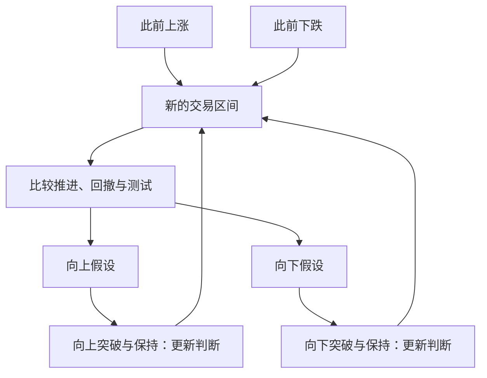

# 威科夫理论全景：从供需逻辑到结构识别、量价验证与交易管理

**整理日期：2026年10月8日。适用读者：希望系统学习威科夫方法、并在中国A股开展客观研究的个人投资者。**

威科夫方法研究的是：价格在什么背景下运行，买卖力量怎样通过价格、成交量和时间表现出来，原有趋势是否受到威胁，市场是否形成新的运动条件，以及交易者应该怎样管理自己的判断与风险。

它的完整性，不在于能把每一段行情都准确命名，而在于把市场判断、品种选择、入场时机、潜在空间、交易管理串成一个过程。学习这套方法，不能只记“吸筹图”和“派发图”，也不能只背Spring、SOS、LPS几个缩写。真正需要掌握的是：**背景决定形态的意义，反应检验原先的判断，风险约束决定是否值得行动。**

本文依据用户提供的《量价｜威科夫专题》资料包，对其中132份文档进行主题归并，围绕核心课程、术语、结构、点数图、比较分析及主要现代扩展开展重点阅读与交叉核对。包内包含重复文档、课程整理、OCR文本及后人扩展；部分图表只有占位符，不能凭文字还原成真实行情案例。因此，本文是一篇系统知识综述，不是132份材料的逐页复述，也不声称涵盖所有流派的每个私有术语。经典主干、现代扩展和本文为客观研究提出的约束会明确区分。

## 一、先确定威科夫方法的边界

### 1. 一套分析与决策方法，不是已验证的万能盈利模型

威科夫把价格行为放在供需关系中解释，并强调比较、测试与交易纪律。它既有市场观察的内容，也有趋势和目标区间的条件性判断。把它说成“完全不预测”并不准确：任何关于未来延续或反转的判断，都是预测。合理的区别是，预测可以被后续证据修正，而不能被写成必然发生的事实。

传统技术分析常谈市场行为反映信息、趋势可能延续、某些行为模式可能重复。它们是研究假设，不意味着价格包含所有事实、历史一定重演，也不意味着基本面与制度可以忽略。现代市场里，机构的目标、期限、策略、资金约束都不同，价格可能因消息、强制平仓、指数调整和流动性变化突然改变。

### 2. 三个层次必须分开

| 层次    | 可以怎样表达                             | 不应怎样表达       |
| ----- | ---------------------------------- | ------------ |
| 可观察事实 | 连续回落；成交量较既定历史基准增加；收盘重新回到已记录支撑区之上   | 主力已经完成建仓     |
| 分析假设  | 该行为与卖压受到承接的解释一致；也可能是短暂回补或流动性变化     | 这是洗盘，后面必涨    |
| 行动条件  | 若确认后的回测保持结构，且风险、流动性与权限满足预定要求，才考虑执行 | 给一个形态命名就立即买入 |

事实、假设与行动之间存在距离。这个距离需要验证，不能靠讲故事跨过去。

### 3. 两条贯穿全文的读图原则

第一，不要期待某个历史模式按同样细节再次出现。市场参与、流动性和制度变化，会让相似结构具有不同路径。示意图用于解释关系，不是要求真实行情逐个完成图上的字母。

第二，当前行为只有放在比较中才有意义。同样的成交量、价格柱和回撤，在不同背景、位置、前序波段中可能支持不同解释。不存在脱离环境、永远不会失败的价格水平或形态。

## 二、综合人：理解大资金影响的思想模型

Composite Man通常译为综合人、合成人，部分教材使用Composite Operator，即综合操作者。它把市场中主要资金的合成影响简化成一个便于思考的角色，帮助读者理解为什么大规模买卖可能需要分批完成，为什么某些价格区间会反复出现承接或供应。

历史课程中的“他在吸筹、他在测试、他在派发”，可以作为解释模型，但不等于有一个真实、统一、能够控制全部价格的庄家。今天的基金、保险、量化机构、游资、做市及个人投资者可能同时交易，且目标相互冲突。同一笔大单也可能是对冲、再平衡或被动资金流，并非方向性判断。

因此，综合人模型最有价值的用法，是思考大资金的执行约束和市场反应；最危险的用法，是把所有涨跌都解释成事先安排好的阴谋。没有持仓、交易主体或其他可靠证据，就不能把某根K线认证为特定机构的行为。

“聪明钱”和“弱势资金”同样是简化概念。机构也会亏损，散户也可能做出合理决策。判读重点应放在行为与风险，而不是参与者身份的道德化分类。[附件核心课程；外部传承说明见参考资料1、2]

## 三、三大定律：整套方法的逻辑基础

### 1. 供需定律：价格朝阻力较小的方向移动

传统表述是需求占优时容易上涨，供应占优时容易下跌。这里讨论的是不同价格下的买卖意愿、主动性、可成交流动性与承接能力，不能机械理解为“成交买量比成交卖量多”。每一笔成交都有买卖双方，成交股数在双方是相等的。

价格上涨可能来自主动买入增加，也可能来自卖盘撤走、可供成交的卖盘变薄；价格下跌也不一定需要天量卖出。小成交量在很薄的市场中，同样可能推动价格大幅变化。

读图时需要问：当前方向上的推进是否容易？遇到关键位置后，对手方是否明显出现？价格是否能保持已经取得的进展？后续波段是否延续同一种关系？

### 2. 因果定律：准备结构与后续运动空间

威科夫传统把交易区间中的准备过程称为“因”，把离开区间后的价格运动称为“果”，并用点数图横向计数估计潜在运动幅度。

它提醒交易者，趋势的发生往往有准备，目标判断应与结构相关。但是，“横有多长，竖有多高”不是自然界的精确定律。横盘时间长，可能意味着供需转换，也可能意味着资金没有兴趣；区间可以向上，也可以向下，甚至继续横盘。

还要区分三个概念：交易区间的时间长度、普通价格图上的横向宽度、点数图中的有效计数。它们不能直接互换。因果定律也不等于统计意义上识别了经济因果关系。点数图目标是特定方法下的投影，不是已经证实的未来价格。

### 3. 努力与结果定律：投入的成交活动换来了多少进展

成交量通常作为“努力”的代理；价格波幅、净推进、收盘位置、突破和保持情况作为“结果”。两者的协调或背离，用来提出关于趋势质量的假设。

结果不能只看阳线实体。很宽的日内波幅但收盘回到原位，和真正突破阻力后收在高位，代表不同结果；大量成交后价格没有下跌，和没有成交所以价格没动，也不是一回事。

| 可观察组合              | 常见解释假设     | 必须继续检查                |
| ------------------ | ---------- | --------------------- |
| 量增加，向上推进扩大，收盘与保持较好 | 需求推进得到价格响应 | 是否撞上重要供应；次日或后续是否回吐    |
| 量增加，向上推进有限，收盘转弱    | 上方可能有较大供应  | 是暂时换手、吸收，还是持续阻止上涨     |
| 量增加，下跌进展缩小，收盘离低点   | 卖盘可能受到承接   | 承接是否持续；反弹是否有质量        |
| 量减少，上涨仍较容易         | 卖方阻力可能减少   | 也可能是流动性稀薄；不能直接认定需求强   |
| 量减少，回落变浅且较慢        | 卖压可能减弱     | 买方是否愿意重新推进；是否只是双方都不参与 |
| 量减少，下跌却很容易         | 买盘深度可能不足   | 不能因为缩量而认定安全           |

“量价必须成正比”过于简单。它们没有固定线性关系；背离也是预警或待解释现象，不是自动反转信号。

## 四、读图的基本语言：价格、成交量与时间

### 1. 价格：位置与推进比颜色更重要

一根K线至少要分开看开盘、最高、最低、收盘、实体、影线以及与上一根的关系。经典柱状图使用OHLC，蜡烛图是一种表达方式；方法的核心不依赖红绿配色。

常见观察项包括：

- **价差或区间宽度**：本根最高价减最低价。在VSA语境中，Spread通常指这个宽度，不是买卖报价差。
- **净推进**：本次收盘与上次收盘、或本波起点之间的变化。
- **收盘位置**：收在自身区间高端、低端还是中部。
- **相对位置**：位于支撑、阻力、区间中部，还是趋势中的延伸位置。
- **重叠与保持**：连续K线是否大量重叠；突破之后是否能在新区域成交并保持。

阳线也可能反映上涨受阻：例如高开冲高后大幅回吐，虽然收盘高于开盘，却低于关键位置。阴线也可能包含承接：例如快速下探后收回，且后续不再延续下跌。颜色本身不够。

### 2. 成交量：必须说明比较对象

“放量”“缩量”“天量”都是相对概念，要说明对比的是此前若干期、同类波段、同一时段还是同一结构阶段。不同股票的绝对成交股数不宜直接比较。股本变化、拆分、交易时段变化和异常交易都会影响口径。

日内量与已经完成的全天量不能直接相比；上午的量应与历史相同时间进度比较。成交股数、成交金额、换手率、成交笔数和报价更新次数也不是同一个量。

量能只能说明成交活动，不直接证明资金净流入、持仓成本或筹码归属。把阳线成交量全部计为主动买入、阴线全部计为主动卖出，属于代理方法，不能当逐笔事实。

### 3. 时间：衡量速度、持续性与成熟程度

同样的价格变化，用一天完成和用十天完成，含义可能不同。急涨慢跌与急跌慢涨，体现不同节奏；但“快就是强、慢就是弱”仍需结合位置与量能。

时间还决定信息能否使用：一根未收完的日K线不是完整日K线；一个等待回测的假设不是已经确认的结构；未结束的波段不能拿未来终点确定其成交量与长度。

## 五、趋势、区间、位置与最小阻力方向

### 1. 三种基本状态

上涨趋势常见更高高点和更高低点；下跌趋势常见更低高点和更低低点；交易区间则表现为某种范围内的反复波动。不同周期可以同时处于不同状态，不能脱离观察尺度说“这只股票是牛市”。

最小阻力方向，是当前证据显示推进相对容易的方向，不等于未来已经确定。它需要由波段、回撤、重要位置的反应和整体背景共同判断。

### 2. 支撑与阻力是区域，不是神奇价位

支撑表示此前出现较强承接或卖压减少的区域，阻力表示此前上涨受到供应或需求减弱限制的区域。它们可以由转折点、区间边缘、关键价格柱及密集交易区域提供参考。

多次接近一个位置，既可能强化市场对该位置的关注，也可能逐渐消耗挂单与承接。不存在“碰得越多一定越强”的通则。突破后原阻力可能成为支撑，原支撑可能成为阻力，但角色转换需要后续表现，不是划线后自动生效。

### 3. 四类趋势线与通道

| 工具  | 传统画法       | 分析用途           |
| --- | ---------- | -------------- |
| 需求线 | 连接上涨中的相关低点 | 观察回撤是否接近原有支撑节奏 |
| 超买线 | 需求线的平行上轨   | 观察上涨是否过度延伸     |
| 供应线 | 连接下跌中的相关高点 | 观察反弹是否仍受压制     |
| 超卖线 | 供应线的平行下轨   | 观察下跌是否过度延伸     |

轴线可用于记录反复发挥支撑、阻力作用的位置。反向趋势线、反向通道则是后续课程常见的画图技术，用于普通连接点难以表达趋势节奏时。线条只概括此前路径，不强迫价格沿线运行。

画线应记录用到的转折点、比例坐标、周期和版本，不能事后不断调整，再宣称以前的判断完全正确。线被穿越是信息，但一次穿越不必然等于整个趋势反转。

### 4. 超买、超卖、留白与削弱

价格超出通道上轨或下轨，传统上称超买或超卖，表示相对既有运动节奏的延伸。它不等于马上反向，也不等于RSI的固定阈值。

部分中文课程使用“留白”“削弱”描述价格未能到达原先常见的通道边缘，或突破原有约束。可将其理解为趋势推进能力变化的线索。要明确所用课程定义，不应把它们转成统一胜率，更不能用事后重画通道制造信号。

### 5. 步幅缩短与50%回撤

步幅缩短，指连续上冲的新高推进或连续下探的新低推进越来越有限。它可能反映趋势动力减弱或对手方增加，但也可能在短暂整理后重新加速。应比较同一级别的波段，并观察时间、成交量与回撤。

50%回撤是传统观察参照，而不是“跌破就必然牛熊转换”的铁律。回撤比例可以定义为“回撤幅度÷前一波推进幅度”，分母必须明确。不同文献也会讨论约三分之一至三分之二的正常修正范围。实际判断仍应结合关键低点、供需反应和风险，不应把50%、61.8%等数字混成保证有效的界线。

## 六、四阶段价格循环与两种延续结构

经典威科夫价格循环包括吸筹、上涨、派发、下跌。它是组织观察的理想化框架，现实走势可以缩短、跳过、失败、嵌套或直接因新信息改变。

| 阶段              | 传统解释               | 图表上应寻找的证据              | 常见误判       |
| --------------- | ------------------ | ---------------------- | ---------- |
| 吸筹 Accumulation | 持仓转移与供应被消化，为上涨形成条件 | 下跌停止、测试变化、承接、相对强势、向上保持 | 低位横盘就是吸筹   |
| 上涨 Markup       | 需求相对占优，价格离开原区间     | 推进与回撤的关系、结构低点、突破保持     | 每根阳线都是主力拉升 |
| 派发 Distribution | 原有持仓转移，供应逐渐占优      | 上涨停止、反弹质量下降、弱势与向下保持    | 高位横盘必然出货   |
| 下跌 Markdown     | 供应或买方缺席占优，价格向下寻找成交 | 下降推进、反弹受限、关键支撑失效       | 跌得很深就没有风险  |

**再吸筹**是上涨过程中可能为继续上涨准备的区间；**再派发**是下跌过程中可能为继续下跌准备的区间。上涨后的横盘也可能是派发，下跌后的横盘也可能是吸筹。过去的方向提供背景，不替当前区间决定结局。

图中表示判断可以随新证据更新，并不表示必须等到完整趋势走完才允许研究或交易，也不把突破当作绝对认证。

## 七、吸筹结构：A—E五个阶段

四阶段循环和A—E分期是两个层次。前者描述价格循环，后者细分一个可能的吸筹或派发过程，不要把它们拼成一串固定“九阶段”。

### 阶段A：原下跌出现停止迹象

常见组合是PS、SC、AR、ST。重点是原有下降节奏是否发生改变，是否开始出现足以阻止继续顺畅下跌的承接或卖压减弱。

PS并不保证止跌，SC也不一定是最低点。随后反弹的高点和回测区域，帮助形成初步区间边界。区间是随着资料出现逐步建立的，不能用后来全部走势确定的边界回填给最初的判断。

有些下降会渐进停止，没有醒目的天量高潮；有些会快速V形反转。没有SC不等于无法停止，有SC也不等于已经反转。

### 阶段B：反复交易与结构建立

传统上称“建立原因”。价格在边界附近反复测试，上下波段质量逐渐变化。观察下跌是否越来越难取得进展、承接是否出现、反弹是否能保持、相对强弱是否改善。

B阶段最容易主观贴标签：很多走势当时同时支持吸筹和再派发的解释。合理做法是保留竞争假设，明确各自需要的下一步证据。

### 阶段C：关键测试

可能出现Spring、Shakeout及后续测试，也可能只在区间内部形成较高低点的测试，不跌破原支撑。这个阶段研究的是供应是否仍能推动价格向下，以及回升是否得到响应。

它不一定是“最后一次洗盘”，也不一定具有统一成交量模式。以Spring作为必备条件，会漏掉无Spring结构；把每次新低都说成Spring，又会掩盖真实下跌。

### 阶段D：需求优势开始较明显地表达

常见SOS与LPS组合。向上波段取得较大进展，回撤的推进能力相对减弱；市场可能开始向区间上部移动并测试阻力。

阶段D仍可能失败、回到区间，甚至转为相反结构。应观察强势之后是否保持，而非只凭一根大阳线宣布“吸筹结束”。

### 阶段E：价格离开区间并发展趋势

向上运动开始在区间外展开，但不保证回撤短浅，也不保证不会重新进入区间。途中可能形成再吸筹，也可能形成新的派发。原来的结构解释需要持续接受市场检验。

## 八、吸筹事件：每一个名称都需要背景和反应

| 事件                | 含义与观察重点                     | 不可直接推出的结论             |
| ----------------- | --------------------------- | --------------------- |
| PS：初步支撑           | 下跌中首次出现值得关注的承接或停止迹象         | 这就是底部                 |
| SC：抛售高潮           | 下跌后成交与波动的显著集中，可能伴离低点收盘及后续反弹 | 当根一定是天量长阴；买方已知是机构     |
| AR：自动反弹           | SC或卖压减弱后出现较明显反向运动，帮助界定上缘    | 必然只是空头回补；必然可以卖到其最高点   |
| ST：二次测试           | 回到先前事件区域比较卖压、波幅、推进与承接       | 缩量就证明熊市结束             |
| Spring：弹簧         | 跌破已建立支撑后重新进入区间，可能形成下破失败     | 每一次破位都是洗盘             |
| Shakeout：震仓       | 较剧烈的下破与收回过程；课程定义可能与Spring重叠 | 剧烈下跌之后一定会涨            |
| Test：测试           | 后续重新接近关键位置，观察原先力量是否仍存在      | 主体已知是在主动测试；未回测也可称测试成功 |
| SOS：强势信号          | 具有较好推进、收盘或保持的向上表现，常伴量能支持    | 任意放量阳线都是SOS           |
| LPS：最后支撑点         | 强势后的回撤或局部测试中，承接位置提供参考       | 现在已经知道这是最后一个低点        |
| BU/BUEC：回撤／回测小溪边缘 | 突破后的重新测试，可是简单回调或新的整理区间      | 突破后一定回测且必然不破          |

“最后支撑点”是传统名称。实时可以说“候选LPS”“截至目前成立的局部支撑”，不能预知以后不会再出现新的低点。多个LPS并不矛盾，但历史标注的变更应留下记录。

### Spring的分类为什么不能机械照搬

不少现代课程按破位深度和成交量，把Spring分成三种：深破且大量的行为往往接近Shakeout，浅破并有一定成交的行为需要仔细观察测试，小幅浅破且低量的行为可能体现卖压较少。不同教材对Spring 1、2、3的编号和“失败型”归类存在差异，不能仅按编号交流。

应直接描述：此前支撑是什么、下破多深、何时收回、成交量相对怎样、收回后如何反应。大成交量既可能意味着供应仍大，也可能意味着强承接；低成交量既可能意味着供应少，也可能意味着没有买方。反应和测试才有助于区分。

Spring失败的典型警报，是不能重新进入区间、收回后迅速再度跌破、后续反弹缺少进展、下跌继续扩大。它不能靠把名称改成“第二次洗盘”就消除。

## 九、派发结构：A—E五个阶段

### 阶段A：原上涨出现停止迹象

常见PSY、BC、AR、ST。需要区分上涨遇到真实供应，与买方暂时不愿追价。两者都可能使上涨停顿，但不必然导向同样规模的下降。

BC可能很醒目，也可能上涨通过需求逐步耗尽结束。高潮之后仍可上涨，局部高潮也可能只是趋势中的短暂事件。

### 阶段B：反复交易与潜在供应转换

观察上涨是否越来越难、向下波段是否取得更大进展、反弹是否无法保持高位。该区间仍可能演变为再吸筹，所以不能因为处在历史高位就确认派发。

### 阶段C：对上方需求的测试

可能出现UT或UTAD，也可能只出现更低位置的反弹和测试。没有UTAD不妨碍形成弱势结构，出现UTAD式行为也不保证马上进入下跌。

### 阶段D：供应优势开始表达

SOW之后，反弹较弱，LPSY提供观察上方供应的参考。价格可能下探或跌破区间下缘。重点在向下推进和反弹失败，而非“主力已经全部卖完”的想象。

### 阶段E：下跌在区间外发展

原支撑可能成为阻力，反弹不能重新建立原有强势。趋势途中可能出现再派发，也可能形成吸筹。市场不会为某一张派发示意图负责。

## 十、派发事件与镜像关系

| 事件           | 含义与观察重点                     | 不可直接推出的结论       |
| ------------ | --------------------------- | --------------- |
| PSY：初步供应     | 上涨中出现值得注意的供应或停止迹象           | 主力开始全部出货        |
| BC：抢购高潮      | 上涨后成交活动与波动显著集中，常伴加速和回吐      | 当根必是天量长阳；以后不再新高 |
| AR：自动回落      | 上涨停止后明显反向下跌，帮助界定区间下缘        | 任意回调都属于派发AR     |
| ST：二次测试      | 再接近BC或阻力，比较需求、供应和保持能力       | 缩量反弹一定是最后出货     |
| UT：上冲回落      | 越过已建立阻力后返回区间，表现为向上突破失败      | 所有上影线都是UT       |
| UTAD：派发后上冲回落 | 潜在派发后段的上破失败，与Spring在结构上互为镜像 | 每个UT都可称UTAD     |
| SOW：弱势信号     | 向下推进、弱收盘或保持体现弱势，常伴供应活动      | 一根阴线就确认熊市       |
| LPSY：最后供应点   | 弱势后的反弹或局部测试无法恢复强势           | 实时已知它是最终最高卖点    |

Spring与UT的镜像，在于突破失败的方向相反；吸筹与派发的镜像，在于观察需求与供应转换的方向相反。现实中的下跌速度、杠杆、交易限制并不对称，所以不能简单把所有数值和执行规则完全取反。

## 十一、小溪、冰线与行为—反应—测试

“小溪”和“冰线”等比喻主要由后来的课程传承发展，用于帮助理解关键边界，不能全都当作威科夫本人最初的固定术语。[参考资料2]

**小溪Creek**通常比喻上涨需要跨越的阻力带；**JOC/JAC**指向上越过这类阻力；**BUEC**指重新接近原阻力边缘。不同资料可能使用不同缩写，但行为定义应一致。

**冰线Ice**通常比喻支撑带；**FTI**表示跌破支撑；**RTI/BUI**表示回到被跌破的支撑附近进行测试。中文资料还出现BOI等写法，不能仅据缩写认定含义一致，应核对原文。有的材料把小溪和冰线混译，这会直接导致方向错误。

行为—反应—测试，常简称ART，是现代教学中有用的组织方式：先观察一个显著行为，再观察相反方向的反应，随后比较重新接近关键位置时的表现。例如：下跌集中—反弹—回测，或向上突破—回撤—再尝试推进。

这条链能抑制单根K线判断，但不能预设三步一定出现，也不能在第三步没有发生时宣称已经完成测试。一次测试以后仍可能出现新供应或新需求。

## 十二、供需变化的四种机制：扩大、吸收、耗尽与保持

### 1. 扩大

当前方向上的成交活动和价格推进同时增强，说明市场较容易朝该方向移动。向下扩大可能体现供应，向上扩大可能体现需求，但具体主体未知。

### 2. 吸收

交易很活跃，却难以朝原方向取得净进展，提示有相反力量承接。支撑附近大量卖出但难以下跌，和阻力附近大量买入但难以上涨，都是可以研究的吸收情境。

阻力附近也可能出现“需求吸收供应”：价格反复测试上方区域，回撤越来越有限，最后向上保持。不能只凭“放量滞涨”就判派发，也不能只凭“低点抬高”就判吸收完成。

### 3. 耗尽

原方向上的力量逐渐不再积极参与。供应耗尽的假设与需求增强的假设不同：前者是卖方减少，后者是买方增加。两者都可能支持上涨，但需要不同证据。需求耗尽也不等于供应已经控制市场。

### 4. 保持与跟随

Follow-through关注行为之后是否有延续。一个强势突破若马上被完全回吐，质量不同于在原阻力上方保持、回撤受限后再上涨。

“没有跟随”只是截至观察时未出现预期响应，可能意味着失败，也可能意味着需要更多时间。何时判定失效必须事先规定，不能一直延长等待期直到结果变好。

### 从单根升级到波段，再升级到结构

| 分析尺度  | 比较对象              | 能回答的问题             |
| ----- | ----------------- | ------------------ |
| 单根价格柱 | 波幅、收盘、成交量、相邻柱     | 当期推进或回吐是否异常        |
| 波段    | 幅度、用时、累计量、效率、回撤   | 同方向力量是否增强；反向力量是否减弱 |
| 结构    | 区间位置、边界反应、阶段与相对强弱 | 哪种解释目前更有证据         |

三个尺度来自相关数据，不是三份天然独立证据。把它们各算一票，可能只是同一条OHLCV信息重复确认。

## 十三、再吸筹与派发、吸筹与再派发怎样区分

这是威科夫实战中最困难、也最容易事后解释的一部分。当市场刚开始横盘时，常常没有足够证据。

| 观察维度 | 更支持向上延续的表现           | 更支持向下发展或延续的表现        |
| ---- | -------------------- | -------------------- |
| 向上推进 | 逐步取得进展并保持            | 上冲不断回吐，难以保持高位        |
| 向下推进 | 回撤较受限，支撑反应持续         | 下跌空间扩大，支撑难以承接        |
| 测试   | 接近低位时供应响应减弱，随后出现有效需求 | 接近高位时需求响应减弱，随后出现有效供应 |
| 相对强弱 | 对基准回撤更有抵抗、反弹更有响应     | 对基准下降更敏感、反弹更迟钝       |
| 边界   | 向上突破后能保持             | 向下突破后能保持             |

这些是条件性观察，不是打满五勾就保证正确。证据矛盾时应降低确定性，甚至只标“交易区间，性质待定”。

倾斜区间、三角形、死角、隐形派发、V形反转，都是需要结合背景的表现形式。波动压缩说明价格空间收窄，不直接说明方向；没有经典顶部形态，也不意味着风险不存在。“隐形派发”若没有可检验标准，容易变成任何失败走势的事后解释。

所谓“失败结构”也不应成为无限补丁。可以记录原假设被否定，以及后来出现了何种新证据，而不是把每段走势都改写成一直正确的故事。

## 十四、相对强弱与自上而下选股

经典五步法中的比较分析，要求把个股与大市及相关股票比较，而不是只看一张独立K线。

上涨环境中，相对强的股票常表现为市场上涨时推进较明显、市场调整时回撤较有限；弱股票可能相反。下跌环境中，即使某只股票跌得少，也不意味着适合立即买入；相对强与绝对上涨是两个概念。

比较可以使用对齐的波段收益，也可以使用价格比值。若定义 `RS = 个股价格 / 基准价格`，比值上升表示这段时间相对表现改善，不代表已经剥离行业、市值或风险因素，也不等于RSI指标。

一个纯教学例子：指数从100升至110，个股从10升至11.5；个股涨15%，指数涨10%，该段个股相对更强。但若比较起点被事后挑选，结论仍可能偏差。基准、区间、分红和复权口径必须一致，并在研究前固定。

自上而下可分为市场、行业或板块、个股三个层次。它们的作用是提供背景与候选范围，不应被当作三个独立Alpha来源。指数上涨也可能只由少数权重股推动，因此可补充市场广度、行业参与度与成交集中度，但这些是现代研究辅助，不是经典方法的必备固定指标。

## 十五、五步法：把理论转成一套工作顺序

| 步骤         | 核心问题                   | 工作产出                   |
| ---------- | ---------------------- | ---------------------- |
| 1. 判断市场    | 当前是趋势还是区间，位置怎样，是否适合参与？ | 方向假设、周期、可参与条件；可以得出暂不参与 |
| 2. 选择品种    | 哪些股票与市场背景相容、相对表现较好？    | 有固定基准和比较口径的候选池         |
| 3. 判断潜在空间  | 结构所支持的目标区间是否足以覆盖风险与成本？ | 条件性目标、主要阻力与估计限制        |
| 4. 检查准备程度  | 是否出现足够的结构、测试与供需证据？     | 候选信号、确认条件、失效条件         |
| 5. 安排时机和管理 | 市场与个股如何配合，怎样执行和退出？     | 完整交易计划及后续管理记录          |

第五步不仅是“大盘一反转马上买”。它强调市场时机、个股行为与交易管理的协调。资料中的“多数股票跟随市场”是总体经验，不应把某个固定比例当作所有年份和证券池都成立的参数。

五步法也不是强迫每次都完成一笔交易的生产线。市场状态不合适、个股性质不清、空间不足、风险无法控制，任何一步都可以停止。

## 十六、九项买入检验与九项卖出检验

下表依据附件中威科夫方法简介及相关课程，按常见现代整理版本归纳。它们是检查清单，不是九个独立统计检验；不同传承版本的编号、描述略有差异。通过九项不等于科学认证，更不能把“六项满足”编成未经校准的60%胜率。

| 序号 | 吸筹后买入检验                           | 派发后卖出／弱势检验                        |
| -- | --------------------------------- | --------------------------------- |
| 1  | 原下降的点数图目标已实现，并核对其计数口径             | 原上涨的点数图目标已实现，并核对其计数口径             |
| 2  | 出现初步支撑、抛售高潮及测试等停止证据               | 量价行为转弱：反弹与回落关系偏空                  |
| 3  | 量价行为偏多：推进与回撤关系改善                  | 出现初步供应、抢购高潮等停止证据                  |
| 4  | 原下降步调或下降趋势线被改变                    | 个股相对市场转弱                          |
| 5  | 形成更高低点                            | 原上涨步调或上涨趋势线被改变                    |
| 6  | 形成更高高点                            | 形成更低高点                            |
| 7  | 个股相对市场更强                          | 形成更低低点                            |
| 8  | 形成可识别的底部准备结构                      | 形成可识别的顶部准备结构                      |
| 9  | 估计收益空间相对初始风险具有足够余量，传统版本常以至少3:1为参考 | 估计向下空间相对初始风险具有足够余量，传统版本常以至少3:1为参考 |

传统使用K线或柱状图、点数图等工具。没有有效点数图时，第1项不能伪填“满足”；如果只研究价格结构，应明确所用的是简化清单。

3:1是目标距离与计划止损距离的比值，不是期望收益，不包含真实命中率，也未自动覆盖跳空、成本与未成交。对普通A股现货投资者，弱势清单主要帮助减少暴露或否决买入，不能自动变成做空许可。

## 十七、点数图：传统目标测算工具

### 1. 与时间图的区别

点数图P\&F主要按价格移动和反转构造列，通常不以等距离时间轴表达行情。常见X列记录上涨、O列记录下跌。它压缩时间噪声，但没有创造新的原始信息；若用同一价格数据构造，仍是价格的另一种表示。

关键参数包括格值Box Size、反转规则、输入价格序列和计数方法。传统一点图、三点图与现代软件的格值、反转倍数命名不总是一一对应，使用时应把实际算法写清楚。

### 2. 横向计数的基本思路

先在价格图上识别相应准备结构，再在点数图上选定计数线、右端和左端。常见现代三格反转横向测算，可概括为：

`预计运动幅度 = 有效横向计数列数 × 格值 × 反转倍数`

然后从事先规定的基准价向上相加，或向下相减。基准可以依方法选择计数线价、区间低点或高点，甚至形成上下目标区间；不同口径不能看结果后切换。

例如，一个纯教学构造中有效计数10列、固定格值0.5、采用三格反转测算，估计幅度为15个价格单位。若预先规定基准20，向上投影为35。这只是公式示例，没有对应真实股票，也没有预测有效性的证明。

### 3. 分段计数与脚踏石结构

有些课程从右侧LPS或LPSY向左分段扩展，先使用较小、较明确的准备结构，再研究更大的计数。这里的“计数分段”不等于吸筹的A—E阶段。不能把所有横盘列都拼进去，直到得到自己想要的目标。

趋势中的再吸筹或再派发常被称为脚踏石结构，它可以提供新的投影。它与早期目标相近，不是两份独立证据；两者可能使用重叠的价格信息。

### 4. 点数图的四类主要风险

- **参数风险**：格值、反转、计数线改变，目标可能显著改变。
- **数据路径风险**：日OHLC不能完整说明当日先到最高还是先到最低，软件构图可能采用约定而非真实路径。
- **时间泄漏风险**：用后来才识别的LPS、完整区间或未来波动率确定早期计数。
- **目标误用**：到达投影不意味着必须反转，没有到达也不意味着应该死扛。

使用ATR或其他动态格值时，必须确认计算只用了当时可用数据，且不会用最新格值重新生成整段历史后伪装成过去的信号。

## 十八、盘口、波段量与交易活动的细化

### 1. 报价带与现代盘口

早期Tape Reading关注逐笔价格、成交及其节奏。现代交易者还会观察订单簿、主动成交、撤单、价差和深度。盘口与图表的合理分工，是前者细化短期执行与反应，后者提供较大结构背景。

挂单不是成交，也可以撤销；看见大卖单不证明机构在派发，看见大买单不证明支撑可靠。公开盘口还可能无法完整展示隐藏流动性和其他场所活动。

“向上吃单”“向下吃单”描述主动成交触及卖价或买价的行为。它不能直接认证最终受益人、动机与后续方向。在低流动性品种，少量成交也可能造成显著价格变化。

### 2. Wave Chart与Weis Wave

波段图把行情拆成上涨波和下跌波，比较每波价格幅度、累计成交量、持续时间及反向响应。David Weis等后续实践者发展了现代波段量表达方式。

上涨波投入很多量却推进有限，可能提示遇到供应；下跌波大量成交却难以创新低，可能提示承接；同等幅度所需成交量减少，可能提示阻力变化，也可能提示流动性变化。背景仍不能省略。

Weis Wave并不天然只使用Tick Volume。可以用实际成交量，也有市场因缺少集中成交量而使用报价更新等代理。Tick Volume、成交笔数和真实股数要分别标注。

波段分割如果依赖未来反转才能确定终点，就不能把最终累计量提前用在波段中部。ZigZag式图形尤其要标明重绘、确认滞后及历史版本。未结束的波，只能显示截至当时的累计值。

### 3. SMI工具：市场波、OP、Force、Technometer

部分SMI课程使用Wyckoff Wave市场指数及OP、Force、Technometer等工具，辅助研究买卖压力和超买超卖。它们属于特定传承和产品工具，不是人人必须实现的经典通用公式。

不能把历史组成股照搬成当前A股指数；没有可核对算法和数据，不能自造一个相似指标再冠以原名认证。资料中的阈值也不应脱离其构造和市场环境移植。它们可以帮助理解传承体系，但不构成当前投研系统缺少的必装模块。

## 十九、VSA、成交量分布、订单流与SMC：哪些是扩展

### 1. VSA：把量、价差与收盘组合成局部信号

VSA即Volume Spread Analysis，与Tom Williams等后续实践相关。它借鉴供需与量价思想，但不能把其全部信号和固定条件追溯为威科夫本人原始规则。

常见概念包括Stopping Volume、No Demand、No Supply、Test、Upthrust、吸收量与高潮量。No Demand通常描述较窄范围、较低量的向上表现；No Supply通常描述较窄范围、较低量的向下表现。不同课程可能要求比较前两根量或等待下一步确认，这些具体条件需要明确版本并验证。

“没有需求”不是市场上真的无人买入，“没有供应”也不是完全无人卖出。它们是特定局部图形的命名。脱离背景，低量上涨可能是卖盘少，低量下跌可能是买盘缺席，所以不能单独据此行动。

### 2. 成交量分布Volume Profile

它按价格区域汇总成交量，和按时间显示量柱不同。常见术语有POC、价值区、HVN与LVN：POC为所选样本中成交最集中的价格区域，HVN为高成交节点，LVN为低成交节点。

这些描述历史成交分布，不证明现有持仓还在该价位，不等于主力真实成本。价值区比例、窗口、价格分箱和数据路径都是方法选择，必须说明。

若只有日OHLCV，把全天量均匀分到高低范围内，得到的是估算分布，不能叫真实逐价成交量。固定区间或锚点若由后来行情决定，同样可能泄漏未来信息。

### 3. VWAP与锚定VWAP

VWAP是指定期间内成交价格按成交量加权的均价；精确计算需要对应成交价格与量。用典型价乘日量计算，是近似，须标明。锚定VWAP从某个事件或日期开始，但锚点不能事后只挑最有利位置。

价格在VWAP上方，不意味着所有机构盈利；VWAP也不等于所有持仓的成本。它可以提供执行或位置参照，不是独立交易真相。

### 4. 足迹图、Delta与累积Delta

订单流Delta通常表示按主动方向分类的买入量减卖出量；这是主动成交归类，不是没有匹配对手方的“净买股数”，也不是期权Delta。不同软件的签名算法和数据质量可能不同。

正Delta同时价格下跌，可能涉及被动卖方承接、时间尺度差异等机制；负Delta同时上涨也不矛盾。足迹图的价值是细化成交，不是读懂所有参与者意图。没有逐笔方向数据，不能从日K线凭空生成“真实Delta”。

### 5. SMC等现代术语

SMC常谈流动性扫荡、BOS、CHoCH、订单块和价格失衡。它们与威科夫的突破失败、结构变化等有部分语义交集，但来源、算法与市场假设不同，不能仅换名称就说增加了一份独立证据。

流动性扫荡也不一定由统一主力设计；所谓订单块不能直接认证未完成的机构订单。多套方法可以做独立研究比较，但融合之前必须证明增量价值。

## 二十、进场、退出与持仓：理论如何成为计划

### 1. 常见的三类做多研究位置

| 类型           | 条件性逻辑            | 优点          | 主要风险              |
| ------------ | ---------------- | ----------- | ----------------- |
| Spring或其测试之后 | 下破失败，反应与测试支持承接假设 | 距结构失效位置可能较近 | 原结构性质仍不明；真实破位被误认  |
| SOS或越过阻力之后   | 等待较明显推进再行动       | 方向证据较多      | 价格可能已远离失效点；可能是假突破 |
| LPS／突破后的回测   | 观察强势之后的保持与再启动    | 可以观察回撤质量    | 回测可能不出现、很深或直接失败   |

它们不是按“激进低胜率、保守高胜率”就能得到数字分类。等待更多确认可能减少某些错误，却提高买入价格或错过机会。真实权衡要靠定义明确的样本评估。

传统派发交易位置可对应UT、SOW、LPSY。对没有合法做空能力的A股现货投资者，应用首先是退出风险和减少暴露，不是模拟一个现实中无法执行的空头收益。

### 2. 入场前写清楚六件事

背景是什么；当前假设是什么；触发条件是什么；哪些事实否定假设；潜在空间与实际风险是什么；在现实交易规则下能否成交与退出。

“出现LPS买入”不够完整。还要明确LPS当时依据哪根已完成K线成立、信号何时可用、买入是否已经偏离计划价格、无法成交时怎样处理。

### 3. 止损、减仓和加仓

止损可以基于结构失效、价格距离、波动或时间，但它是行动计划，不保证一定成交，也不保证最终亏损不超预算。设得很近，可能只是正常噪声就触发；设得很远，可能使该交易不值得参与。先确定合理的失效逻辑，再判断能承受多少规模。

加仓应属于预先设计的计划，并检查全部仓位共同失效时的风险，不只是看第一笔有浮盈。摊低成本不能因为“主力还在吸筹”的推断而无限继续；若研究均值回归或分批建仓，也要有独立规则、预算和失效条件。

退出可以来自结构破坏、目标附近供需改变、时间条件、组合风险或执行限制。到达点数图目标后重新观察，不等于机械全卖；未达到目标也不构成继续持有的理由。

## 二十一、资金管理与组合风险

将价格结构转成风险，应区分资金仓位、标的波动和账户损失。若以计划止损估算单笔数量，基本形式是：

`计划数量 ≤ 单笔计划风险预算 /（入场到失效位置的每股距离 + 每股成本与滑点估计）`

随后还要约束资金、可买卖单位、可成交深度、可卖数量、隔夜和组合风险。这个估算在正常成交假设下成立，不能覆盖无法卖出的极端情况。

单笔1%、2%、总风险6%等比例来自不同交易传统或教学示例，没有一组能自动成为所有人的最优值。将多只同板块股票各控制1%，也不代表组合最多损失几个百分点；相关性可能在压力下明显上升。

评估策略需要成本后胜率、盈亏分布、最大回撤、恢复时间、尾部损失、集中度和容量。期望值可以写成“获胜概率×平均盈利−失败概率×平均亏损−成本”，但每个输入都需要样本及不确定性；目标盈亏比不是平均实际盈亏比，历史正期望也不保证未来继续成立。

未经校准的“形态胜率”和主观概率不允许进入Kelly或其他仓位公式生成认证建议。再精密的数学，也不能给没有证据的输入补真实性。

## 二十二、多周期分析：同一市场可以有多种方向

大周期可以用于观察整体位置，中周期用于研究结构，较小周期用于细化触发或执行。但大周期不必永远压倒小周期，也不存在通用“周线必然指导日线、日线必然指导小时线”的固定配方。使用哪些周期，应与持有期限和验证设计匹配。

周线吸筹假设中可以出现日线下降；日线上涨中可以出现小时线派发。小级别反转不能直接升级成大级别反转，大级别看多也不能取消短期失效与交易限制。

尤其要注意未完成的高周期K线：周三时本周最高、最低、量和收盘仍会变化，不能使用周五完整周线来认证周三判断。多周期特征源自重叠价格信息，不能把它们当独立样本叠加置信度。

## 二十三、中国A股适配：交易现实必须进入分析

### 1. 普通股票的可卖数量与隔夜风险

普通A股当日新买入股票通常不能当日卖出；已有可卖持仓与新买入持仓需要区分。不能把海外日内方法直接移植为当日进出模型，也不能默认一个日内失败信号可以让当天新仓马上止损。[参考资料3]

因此，信号识别、订单时点、可卖库存和持有期应在研究中分别记录。“等收盘确认”能减少使用未完成日线的问题，却不等于风险小：收盘后才能知道的信号，不能回测成收盘前以该价格成功成交。

### 2. 涨跌停、停牌和无法成交

涨跌幅限制按交易所、板块、风险警示状态、上市阶段和历史生效日期变化，不能在全部历史写死“普通10%、ST5%”。例如，上交所2026年交易规则修订及技术实施指南已涉及主板风险警示股票限制比例由5%调整为10%，规则发布通知载明自2026年7月6日起施行，且存在部分条文暂缓实施；具体研究应核对相应条文及例外。[参考资料3、4]

涨停低成交量，可能受价格上限与卖盘限制影响，不等于自然供应完全耗尽；跌停窄幅，也可能是价格被限制，不能误读为下跌受到强承接。回测需要知道订单能否成交，不能看见价格触及止损就默认全部卖出。

### 3. 行情、公告、股本与证券状态

除权除息、股本变化、停复牌会改变价格与量的可比性。用于研究的复权口径要明确，还要审查复权因子是否在历史决策点可知，不能只看当前软件画出的平滑图。

财报和公告按可用时间进入分析，盘后发布的资料不能进入当日下午更早的判断。历史股票池应包含当时存在但后来退市的证券，ST、上市日和流通股本也必须是当时版本。

### 4. 流动性与重大风险不能由形态排除

漂亮的吸筹图不能排除财务造假、重大诉讼、退市、控制权风险或突然停牌。技术分析提供价格行为视角，不替代事实核查。低价、小市值和高换手也不能自动认证为机会。

对个人投资者，有利的约束往往是让候选范围、观察周期与执行能力相匹配，而不是增加更多盘口和高频模块。

## 二十四、严防过拟合、未来函数与幻觉

这些是本文为现代客观研究明确提出的约束，不应伪称都是威科夫原著中的计算机规则。

### 1. 未来函数不只是一行shift错误

它可以藏在事后区间、未来确认的转折点、重绘波段、完整周线、当前财务和证券状态、复权序列、模型训练及报告时间里。

至少应区分：事件发生时间、最后依赖数据的可用时间、分析决策时间、最早可执行时间。若某次低点需要后续两根K线才能确认，则低点发生日不能已经获得“确认后的信号”。

一个纯教学时间例子：第1天跌破既有支撑；第2天收回；第3天测试后获得新增证据。第1天只能记录下破，第2天可记录下破失败候选，第3天才可使用第3天新增证据。不能把第3天的信息倒签为第1天已知。

固定历史前缀，追加未来数据之后，已经确认且已归档的当时输出不应被偷偷改写。临时标签允许变化，但要明确标临时、记录版本，并禁止将最新最终标签当作早期特征。

### 2. 过拟合可以来自主观读图

不仅参数搜索会过拟合。事后换区间、改支撑、换周期、重新给Spring命名、删掉失败案例、只看涨得好的股票，都可能在挑历史赢家。

防范方法包括：预先写明定义与参数；保留每次尝试和失败；开发、验证与最终留出分开；训练期内完成特征和阈值选择；使用成熟标签并处理重叠；开展真实时间顺序的回放；计入成本及现实成交。

辅助层应先独立验证。VSA、RVOL、均线、MACD、价格行为、筹码等多数可能依赖同一OHLCV，十个同向指标不等于十份独立证据。未证明增量之前，保持观察或Shadow，而不是把“共振”变成核心加分。

### 3. 幻觉常常表现为解释比证据更具体

“主力成本12元”“这根阴线是机构洗盘”“成功率87%”“已完成吸筹”等，如果没有数据、定义与校准来源，就是超出证据的断言。

大模型可以帮助整理术语、寻找矛盾、提出研究假设和解释已核实结果，但不能代替程序生成真实成交量、PIT数据、样本统计或交易准入。资料缺失时应保留未知，不能补出看起来完整的数字。

对当前投研体系，理论学习不改变生产权限：威科夫结构本身也需要客观定义和验证；辅助层继续独立研究，不能因课程权威、名称熟悉或案例漂亮而晋升。

## 二十五、把知识组织成每日可执行的分析记录

一次分析可按下面顺序写成连贯记录，而不是把术语堆满图：

**先写环境。** 数据截止何时，使用哪些周期，大市与相关板块处于什么状态，标的是否具备可交易条件。

**再写结构。** 已记录的支撑、阻力、转折点是什么；目前有哪些事件候选，哪些已确认，哪些仍待测试；当前阶段判断有哪些不确定性。

**接着比较力量。** 相邻上涨波与下跌波的幅度、用时、量与保持怎样变化；相对市场表现如何；哪些事实同时也支持另一种解释。

**然后写下一步。** 哪种后续行为会加强假设，哪种会削弱或否定，等待多久或到何种事件就停止等待。

**最后写计划。** 若具备执行权限，触发价、失效条件、目标区间、风险与成本、可卖库存和无法成交处理是什么；没有权限或证据不足则只形成观察记录。

可用的简表如下：

| 项目    | 记录内容                   |
| ----- | ---------------------- |
| 时间与数据 | 决策时间、数据可用截止、来源、缺失与版本   |
| 市场背景  | 周期、趋势或区间、位置、板块参与情况     |
| 已知结构  | 边界与转折依据、已确认事件、待定事件     |
| 主假设   | 支持它的可观察事实              |
| 竞争假设  | 同一走势还可能怎样解释            |
| 确认与否定 | 事先写明后续行为及等待终止条件        |
| 风险与现实 | 成本、跳空、成交、可卖数量和相关持仓     |
| 结果复核  | 保留当时判断；后续事实是否符合，偏差来自哪里 |

复盘要评价当时决策是否使用了合法信息、是否遵守风险，而不是只用赚钱与否判好坏。一次正确决策也会亏损，一次违规决策也可能赚钱。

## 二十六、最容易误学的十八个问题

| 误解              | 更准确的认识               |
| --------------- | -------------------- |
| 低位横盘就是吸筹        | 也可能再派发、无人参与或性质未明     |
| 高位横盘就是派发        | 也可能再吸筹或其他整理          |
| 吸筹必须有Spring     | 无Spring的内部测试结构也存在    |
| 派发必须有UTAD       | 需求很弱时可能只出现较低反弹       |
| SC／BC就是最终最低／最高  | 可以是局部高潮，之后仍可延续趋势     |
| 放量滞涨必然出货        | 也可能吸收、换手或短暂停顿        |
| 缩量下跌一定安全        | 也可能没有买盘、流动性不足        |
| 一根长下影就是Spring   | 需要既有支撑、突破失败及后续反应     |
| SOS一定发生在区间外     | 可先在区间内部表达强势，边界突破另需观察 |
| LPS现在就是最后低点     | “最后”是传统名词，实时不能预知未来   |
| 突破一定回测          | 回测可能不出现；出现也不保证成功     |
| 跌破50%必然牛熊转换     | 这是参照，不是确定性界线         |
| 点数图目标一定到达       | 是条件性投影，对算法与区间选择敏感    |
| 越多指标同向越可靠       | 可能是同一价格量信息反复表达       |
| 大资金不会出错         | 身份不能替代行为与证据          |
| 盘口大买单等于真需求      | 挂单可撤，未必成交，主体也未知      |
| 止损保证最多亏预算比例     | 跳空、涨跌停、停牌和限制可使损失超预算  |
| 完整历史标注可以拿来做实时信号 | 需要核对每项标注当时何时可知       |

## 二十七、术语总表：记行为，不只记缩写

| 英文／缩写                            | 中文与注意事项                                       |
| -------------------------------- | --------------------------------------------- |
| Composite Man / CM               | 综合人、合成人；思想模型，非已知统一庄家                          |
| Composite Operator / CO          | 综合操作者；不同课程用法需核对                               |
| Supply / Demand                  | 供应／需求；不等于成交双方股数不相等                            |
| Effort / Result                  | 努力／结果；量的代理与多种价格响应                             |
| Cause / Effect                   | 准备过程／运动投影；非统计因果证明                             |
| Trading Range / TR               | 交易区间；性质可能未明                                   |
| Accumulation                     | 吸筹；结构解释，不能直接认证机构持仓                            |
| Distribution                     | 派发；结构解释，不能直接认证机构卖出                            |
| Markup / Markdown                | 上涨／下跌趋势发展                                     |
| Reaccumulation / Redistribution  | 再吸筹／再派发，属于延续结构解释                              |
| PS / PSY                         | 初步支撑／初步供应                                     |
| SC / BC                          | 抛售高潮／抢购高潮                                     |
| AR                               | 吸筹中Automatic Rally；派发中Automatic Reaction，方向相反 |
| ST                               | 二次测试；并不代表只能测第二次                               |
| Spring                           | 下破支撑后收回的弹簧行为                                  |
| Shakeout / SO                    | 震仓；与Spring定义可能重叠                              |
| Terminal Shakeout / TSO          | 终极震仓；实时不能预知“终极”                               |
| UT / UTAD                        | 上冲回落／潜在派发后段上冲回落                               |
| SOS / SOW                        | 强势／弱势信号；不同于认证交易权限                             |
| LPS / LPSY                       | 最后支撑／最后供应；可有多个局部候选                            |
| Creek / Ice                      | 阻力“小溪”／支撑“冰线”                                 |
| JOC / JAC                        | 越过小溪；不同传承缩写不同                                 |
| BU / BUEC                        | 回撤／回到小溪边缘                                     |
| FTI / RTI / BUI                  | 跌破冰线／回到冰线；需核对材料写法                             |
| COC / CHoCH                      | 性质或特征改变；不同体系定义不完全一致                           |
| Follow-through / FT              | 跟随、延续；观察窗口要预先规定                               |
| Absorption                       | 吸收；方向及位置必须说明                                  |
| Exhaustion                       | 耗尽；与相反力量增强不同                                  |
| Floating Supply                  | 浮动供应；不能从量柱精确计算剩余筹码                            |
| Thrust / Shortening of Thrust    | 推进步幅／步幅缩短；常见缩写并不统一                            |
| SOT                              | 材料中可指停止行为或其他课程概念，不自动统一翻译                      |
| HH / HL / LH / LL                | 更高高点／更高低点／更低高点／更低低点                           |
| Demand Line / Supply Line        | 需求线／供应线                                       |
| Overbought / Oversold            | 超买／超卖，需说明相对何种参照                               |
| Axis Line                        | 轴线；反复发挥支撑阻力作用的位置参照                            |
| Tape Reading                     | 报价带或盘口解读；历史与现代数据内容不同                          |
| Wave Chart / Weis Wave           | 波段图／魏斯浪；分割可能存在确认滞后                            |
| P\&F / Box Size / Reversal       | 点数图／格值／反转规则                                   |
| VSA / Spread                     | 成交量价差分析／价格柱高低范围，不是买卖报价差                       |
| No Demand / No Supply            | 无需求／无供应型信号，非真正零买卖                             |
| Stopping Volume / Test           | 停止量／测试型信号，具体规则依版本                             |
| Volume Profile / POC / HVN / LVN | 成交量分布／最大成交节点／高量节点／低量节点                        |
| VWAP / AVWAP                     | 成交量加权均价／锚定成交量加权均价                             |
| Delta / Cumulative Delta         | 主动成交量差／累积差；区别于期权Delta                         |
| BOS / Order Block / FVG          | SMC相关结构突破／订单块／失衡区域，非经典威科夫必备                   |
| 标K / VDB / VSB                   | 中文课程标志柱／需求柱／供应柱，定义与阈值需标版本                     |
| ABS / ABD / 3D等                  | 课程特定缩写，不在无上下文时假定统一含义                          |

有的材料把GOC写成区间突破，有的又混作Change of Character；把Spring译成“上翘”也容易造成方向误会。遇到这类情况，应写完整的价格行为，不靠猜英文缩写补结论。

## 二十八、学习这套理论应该训练什么

第一项能力是描述。只写已经发生的价格、量与时间关系，能把“放量大阳线”进一步拆成位置、净推进和保持。

第二项能力是比较。既比较同一股票连续波段，也比较个股、市场与板块，且能说明周期、窗口和口径。

第三项能力是假设与否定。同时保留至少一种合理替代解释，并明确下一步怎样判错。不是所有区间都需要命名，不知道也是合格输出。

第四项能力是时间意识。隐藏未来走势，逐根推进，记录每次判断何时形成，不能训练成看完整图后准确标注、但实时无法使用的人。

第五项能力是交易管理。让计划、风险、成交与退出完整，知道自己在A股究竟何时可以卖出，以及如果无法卖出会发生什么。

第六项能力是研究验证。将主观概念变成可审查定义，保留失败案例与试验记录，逐项验证，拒绝用漂亮示例证明一套体系。

威科夫方法的长期价值，是迫使分析者反复回答同一组具体问题：**现在处于什么背景，哪一方的推进较容易，关键位置怎样反应，什么会推翻判断，判断错误时损失怎样被管理。** 当这些问题都有可追溯的答案，理论才真正成为研究工具；只有术语和故事时，它仍只是解释行情的语言。

## 资料说明与参考

本文以附件文本为知识归纳的主要依据，关键采用的材料包括：

1. `Wyckoff-Method_Wyckoff-Analytics_Mandarin-V2.md`、`Wyckoff_Method-Mandarin.md`、`威科夫方法简介和全套术语.md`：五步法、三大定律、事件与阶段、九项检验、点数图。
2. `Wyckoff-5-Step-Method.md`、`Wyckoff-Relative-Strength-And-Weakness.md`、`Wyckoff-Timing-Your-Commitments.md`、`Wyckoff-Buying-And-Selling-Tests.md`：工作顺序、比较分析及交易时机。
3. `Figure-charts.md`、`Trendlines-Refinements-in-charting.md`、`Intraday-swings-with-wave-charts.md`：点数图、趋势线与波段观察。
4. `威科夫原著｜威科夫操盘术.md`、`威科夫理论大全集.md`、`威科夫交易方法手册.md`：盘口、交易准备、成本、纪律与风险。
5. `TOM威科夫方法理论·知识·技术学习手册.md`、`威科夫操盘法知识要点手册.md`、`威科夫操盘法·学习手册.md`及其他中文手册：现代教学中的测试、蓄势、多周期、标志柱和交易管理；其课程特定阈值未直接采纳为通用规则。
6. `威科夫基础课程公开课.md`、`威科夫进阶课程.md`：特征改变、ART与结构分期。
7. `David Weis-Trades About to Happen A Modern Adaptation of the Wyckoff Method 翻译.md`、`找准下一个买卖点.md`：波段量与现代适应。
8. `驱动股市的不公开的秘密-汤姆威廉姆斯.md`、`成交量价差分析法VSA.md`、`读图大师班大师VSA班培训课件.md`：VSA扩展。
9. `威科夫2.0（西班牙）.md`、`VOLUME_PROFILE机翻_.md`、`聪明钱概念对威科夫方法学的现代适应.md`：成交量分布、订单流与现代术语。
10. `威科夫体系知识点提取报告.md`、`威科夫体系A股适配技术手册.md`：用于主题检索与交叉对照；其中确定性表述、固定风险比例、部分术语和过时制度口径在正文作了限缩或纠正。

外部资料用于核对传承、方法概要及当前制度，不用于证明威科夫具有已认证的盈利能力：

- [参考资料1：Wyckoff Analytics，Wyckoff Method](https://www.wyckoffanalytics.com/wyckoff-method/)。概述五步法、阶段、事件与方法工具；中文版本亦在附件中。
- [参考资料2：Wyckoff Stock Market Institute，Original Course](https://wyckoffstockmarketinstitute.com/course/)。说明历史课程与Robert Evans后续发展的部分术语。网页中的盈利宣传不作为本文实证结论。
- [参考资料3：上海证券交易所交易规则（2026年修订）发布通知](https://www.sse.com.cn/lawandrules/sselawsrules2025/stocks/exchange/c/c_20260424_10816482.shtml)。发布日期2026年4月24日，通知载明2026年7月6日起施行，并说明部分条文暂缓实施；具体证券的规则应核对原文、补充通知及当时生效版本。
- [参考资料4：上交所交易规则修订市场参与者技术实施指南](https://www.sse.com.cn/services/tradingtech/development/c/10816505/files/8006a51174524e7cae832568b5e726a6.pdf)。用于核对主板风险警示股票涨跌幅比例修订；业务适用以交易所业务规则为准。

正文中的数字演示均明确标为教学构造，不对应真实证券或历史收益。本文没有计算真实胜率、收益率、主力成本或策略有效性，也未将资料中的故事和业绩转化为认证事实。
